# Golf UI style guide

A description of the shipped visual language, not a redesign. Baseline: public main `0c5a0fcc1dd4f8ee3ba36199fe2e3ff73685c6c7`, 13 October 2026. The application source is unchanged in this documentation branch; the additional files are the guide, screenshots and synthetic evidence harness.

## Read this first

The app uses a light, green-led dashboard around a more compact on-course scoring experience. White cards, rounded corners, deep green primary actions and a yellow handicap label form the strongest shared vocabulary. Detailed scoring also has darker overlays and denser controls. Document those differences rather than flattening them into one new design.

This inventory is descriptive. Existing small controls, contrast failures, text overflow and inconsistent inline values are tracked debt, not approved accessibility patterns. Separate accessibility, tap-target and admin-approval fixes must be reviewed and integrated on their own merits. This guide does not certify WCAG compliance.

## Palette already available in `src/style.css`

| Existing custom property | Value | Current role |
|---|---|---|
| `--primary-color` | `#0b2e13` | Primary actions, headings, gradient start |
| `--secondary-color` | `#1a5829` | Hover/focus accents, gradient end |
| `--accent-color` | `#f1c40f` | Flag-yellow index label |
| `--bg-color` | `#f4f7f6` | Page background and subtle separators |
| `--card-bg` | `#ffffff` | Main card surfaces |
| `--text-main` | `#2d3436` | Default text |
| `--text-muted` | `#636e72` | Secondary copy |
| `--border-color` | `#dfe6e9` | Default card/input borders |
| `--used-color` | `#e8f5e9` | Counting-round emphasis |
| `--used-border` | `#4caf50` | Counting-round border emphasis |
| `--danger` | `#ff7675` | Existing destructive/text-action accent |

There are also literal white, slate, blue, green, amber and red values outside these tokens, plus translucent dark scoring surfaces. The same literal can serve different roles; replacing every matching colour with one semantic token would conflate those roles. Check contrast for the actual foreground/background/state before reusing a colour.

## Type

- Declared family: `Outfit, sans-serif`; body line height 1.6. External web fonts are denied in the isolated screenshot harness, so the evidence uses its available sans-serif fallback. It is not proof of downloaded Outfit rendering.
- Common font sizes in CSS: 0.8, 0.85, 0.9 and 1rem; the baseline contains 47 distinct lexical `font-size` values. Do not describe it as an already unified type scale.
- Shared form labels: 0.9rem / 600. Standard inputs and `.btn`: 1rem, inherited family; buttons use weight 600.
- `.branding h1`: 2rem / 800. `.card h2`: 1.4rem. The handicap number is 4rem / 800 with line height 1.1; it is a special display element, not the default page heading.
- Some navigation labels and dense scoring labels are much smaller. Do not spread these to body text or treat the baseline as a readability target.

Prefer the existing semantic element and class before adding a new inline font declaration. Rem values must continue to respect the user's text settings; a token-consolidation patch must not turn them into fixed pixels.

## Space, shape and depth

| Pattern | Baseline definition |
|---|---|
| App container | max-width 1000px; centred; 20px padding, 120px bottom padding |
| Dashboard | Two `minmax(0, 1fr)` columns, gap 30px; one column at ≤900px |
| Standard card | 12px radius; 30px padding; 1px default border; soft `0 4px 6px rgba(0,0,0,.03)` shadow |
| Player-management bar | 8px radius; 15px 20px padding; subtle border/shadow |
| Compact score card | 12px radius; 8px 12px padding; 8px gap; white surface |
| Header | Green gradient; 12px radius; 18px 24px padding; 20px bottom margin |
| Form row | Wraps, gap 20px, margin-bottom 20px |
| Form group | Flex column, min-width 150px; some specialised forms override this |
| Typical input | 12px 15px padding; 6px radius; 1px default border |

There are 17 distinct radius values and 23 distinct shadow values. Responsive and later selector overrides still apply: these are the base definitions, not a guarantee that every screen computes these dimensions.

## Controls and states

### Standard actions

`.btn` defines 12px 24px padding, 6px radius, inherited font, 600 weight, 1rem text and a pointer cursor. `.btn-primary` uses deep green and white, fills the available width and has a 10px top margin. Hover moves it up 2px and uses the secondary green. `.btn-secondary` uses a pale grey surface. `.btn-text` is a lightweight action with the existing danger accent; disabled text actions have reduced opacity and a default cursor.

Preserve native `button`, `input`, `select`, `details` and `summary` semantics. A colour token is not a substitute for an accessible name, state or disabled attribute. Destructive actions need clear wording and their existing safeguards.

### Forms and focus

The shared form focus rule uses the secondary-colour border and a three-pixel translucent ring after suppressing the default outline. This guide records that implementation; it does not declare that every specialised form has sufficient focus contrast or consistent validation. Keep labels and error descriptions associated with their controls.

### On-course controls

The compact scorer, stepper controls, FW/GIR toggles, More menu and full-screen detailed flow have specialised selectors and dimensions. Reuse those components rather than adding another score-entry pattern. The baseline's small putt/toggle targets are known debt; token extraction must not silently resize them or claim to fix them.

### Navigation, visibility and layering

Visibility belongs to `AppState`, `body[data-active-tab]` and the existing `hidden` class. Do not introduce `.style.display` for screen navigation or new `!important` declarations. Keep the sanctioned role/pressed-state exceptions in `AGENTS.md` separate from navigation.

The layer-map comment at the start of `style.css` documents the existing hierarchy: ordinary content 10–50, progress/subnav 99, active round 500, floating actions 1001, wizard layers 2000–2001, modal overlays 9999, initialisation cloak 10001 and main navigation 99999. Treat these as current implementation facts; check actual overlap before adding another layer.

## Inventory and scope

The accompanying [machine-readable inventory](style-inventory.json) records exact values and per-file counts. Its method is explicit:

- CSS comments removed before counting: 124 distinct hex/function colour tokens, 79 occurring once; 47 font sizes, 17 radii, 23 shadows, 11 existing custom properties, 50 executable `!important` occurrences.
- HTML contains 645 lexical inline `style` attributes.
- HTML/JS colour scanning includes comments and template strings. These are source occurrences, not counts of rendered elements. Named colours are excluded from the hex/function colour total.
- The earlier fleet's raw-text count was 125 colours / 51 `!important`; this census uses comment removal and a documented token scan, so the figures are not a directly comparable trend line without rerunning both methods on the same source.

Do not claim that moving only the common CSS values removes all inline styling or fixes all design inconsistency.

## Screenshot evidence

Screenshots are generated from the production-mode local build with demo emulators, invented users/rounds and a test-only synthetic course catalogue. No real account, GPS position, live site or preview is used. Both 412×839 and 375×667 Chromium phone profiles are covered; the latter is not Safari/iOS validation. The test build uses a fixed synthetic build label. The local emulator warning remains visible; no screenshot region is masked. No app layout is changed to make the screenshots look better.

The [100-capture screen census](style-screen-census.json) records each path, dimensions and SHA-256. Both complete persona journeys passed in 5.4 minutes. The full unit suite passed 139 files / 1,343 tests; these checks do not constitute an accessibility pass. Four admitted roles cover every visible top-level tab; a fifth account covers pending/approval recovery. Login/register, history actions, past-round entry, nine-hole setup/scoring, More, finish/save and post-round states are included. This is not every possible dialog/data permutation.

The twelve selected screenshots below were visually inspected; full-page captures retain fixed navigation at its viewport position. All course names, rounds and mapped geometry in these fixtures are invented. The safety assertion rejects real-club names before every capture.

| State | 412 px | 375 px |
|---|---|---|
| Sign-in | 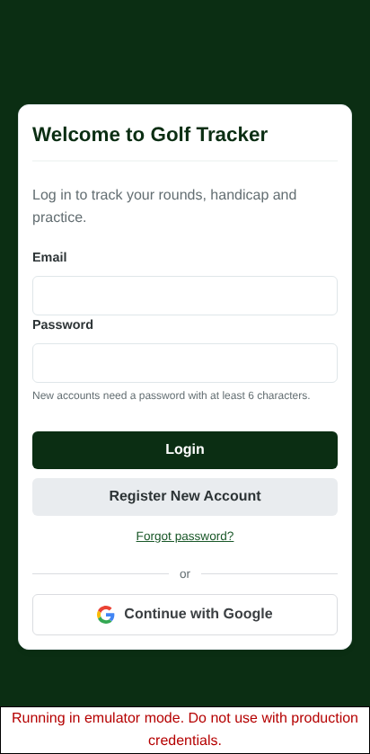 | 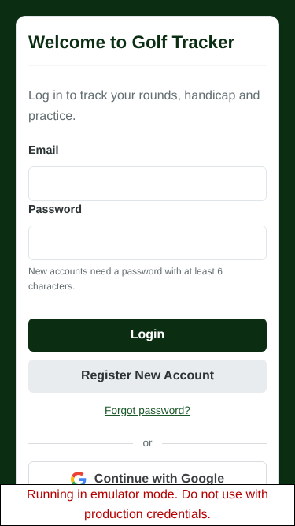 |
| Empty Handicap | 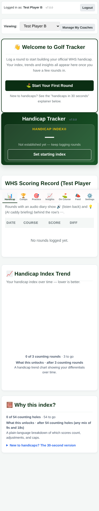 | 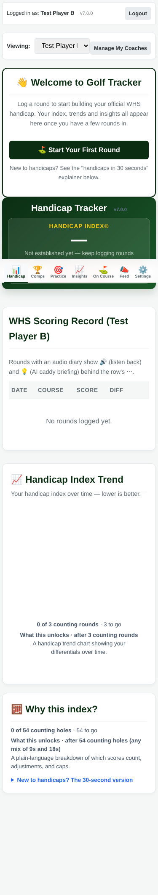 |
| Populated Handicap | 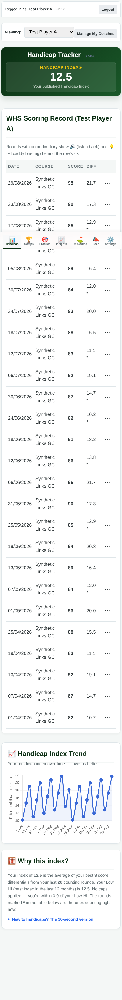 | 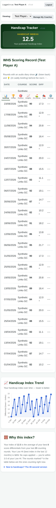 |
| Nine-hole setup |  | 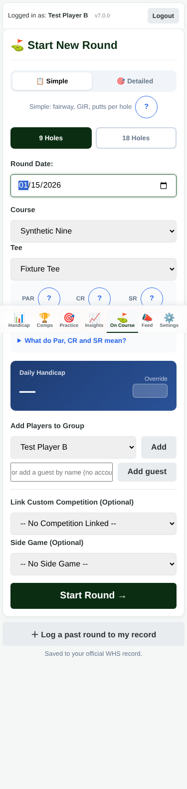 |
| Scoring | 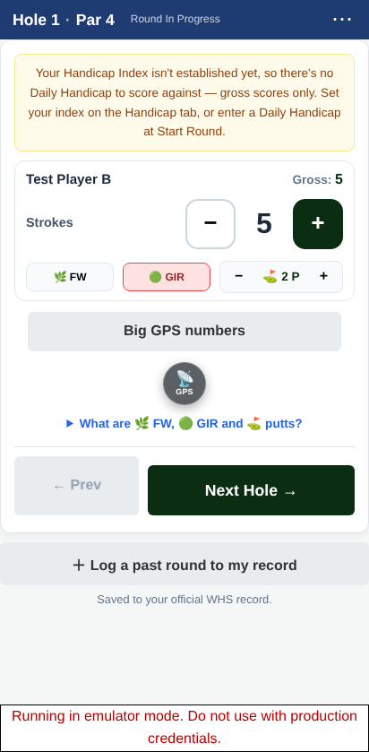 | 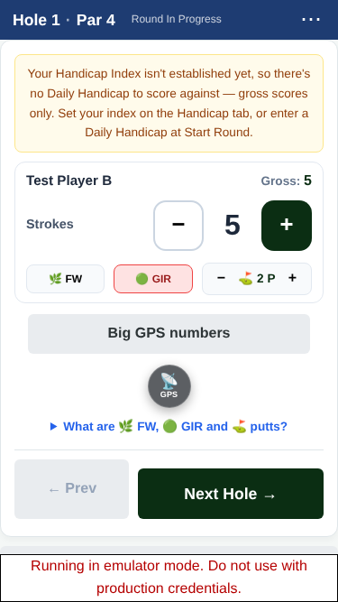 |
| Settings | 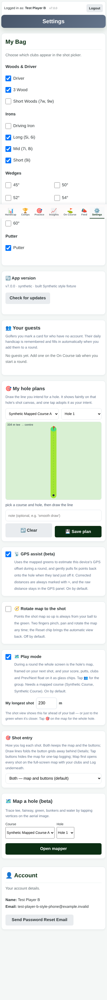 | 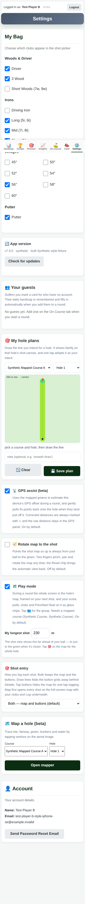 |

Reproduce through `node scripts/run-e2e-isolated.mjs --config playwright.visual.config.js` after installing the locked dependencies and configuring the pinned local browser. The configuration retains the demo-only network guards. The test-only Vite config replaces the course catalogue, mapped-course labels and overlay geometry, never the normal production configuration. Historic cards are 26 invented eighteen-hole records, seeded while the app is unloaded; the journey separately saves a nine-hole round. Fixed demo-only Auth IDs keep admin row ordering reproducible. That identity bootstrap intercepts signup to seed a fixture and return an emulator sign-in response, so this is not an Auth signup-conformance test. Verification and admission UI still run. Captures bring the page to the foreground and start at scroll origin, with no masks or changed application styles. For a populated visible handicap chart, the harness waits for plotted blue pixels and consecutive equal canvas images; it reads rather than replaces or redraws the chart.

## Follow-on token consolidation

A separate independent branch proposes exact-value aliases for two gaps (8px/10px), two radii (8px/12px) and three recurring text sizes (0.85/0.9/1rem). Numeric names deliberately describe the existing values without inventing new semantic roles. No new palette, dimensions, selectors, layout rules, visibility rules or product behaviour are proposed.

Acceptance must include: expanding the new aliases reproduces the original stylesheet byte for byte; before/after computed-style and screenshot comparisons over the same synthetic screen census; unit checks; and a clear account of any differences. Do not fold accessibility redesigns or other pending branch changes into a zero-visual-change claim.
